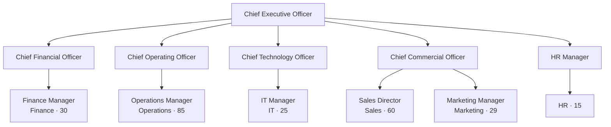

# GreenTech Solutions Ltd. — Company Profile

> **Fictional organization.** GreenTech Solutions Ltd., its staff, partners, applications and domains are invented for a Microsoft Entra ID identity governance lab. Any resemblance to real organizations or people is coincidental.

## 1. Overview

| Item | Detail |
|---|---|
| Legal name | GreenTech Solutions Ltd. |
| Industry | Renewable energy services (commercial solar and energy efficiency) |
| Founded | 2016 |
| Headquarters | Toronto, Ontario, Canada |
| Other sites | Mississauga warehouse and logistics hub; field crews across Ontario |
| Employees | 250 permanent staff, plus ~10 contractors and 5 external partner organizations |
| Annual growth | ~20% headcount growth per year; high turnover among field technicians |
| Primary cloud platform | Microsoft 365 and Microsoft Entra ID; Azure for internal tooling |
| Privacy context | Handles employee payroll data and customer site/billing data (Canadian privacy law applies, e.g. PIPEDA) |

### Mission
Help Ontario businesses cut energy costs and emissions through reliable solar, battery storage and energy-efficiency solutions — delivered safely, on time and with trustworthy data handling.

### Business services
1. **Commercial solar installation** — design, permitting and installation of rooftop and ground-mount systems.
2. **Battery energy storage** — installation and maintenance of on-site storage systems.
3. **Energy audits** — on-site assessments with efficiency recommendations.
4. **Operations & maintenance contracts** — monitoring, inspections and warranty service.

## 2. Organizational structure

### Headcount by department (total = 250)

| Department | Headcount | Head | Reports to | Notes |
|---|---:|---|---|---|
| Executive Office | 6 | CEO | Board | CEO, CFO, COO, CTO, CCO, Executive Assistant |
| IT | 25 | IT Manager | CTO | Service desk, identity, cloud, security, network |
| Finance | 30 | Finance Manager | CFO | AP/AR, payroll, analysis, procurement |
| HR | 15 | HR Manager | CEO | Recruiting, HR admin, L&D, health & safety |
| Sales | 60 | Sales Director | CCO | 4 regional teams, SDRs, customer success |
| Marketing | 29 | Marketing Manager | CCO | Digital, content, design, events, PR |
| Operations | 85 | Operations Manager | COO | Installers, auditors, supervisors, logistics |
| **Total** | **250** | | | |

Non-employee identities (not counted in the 250): **10 contractors** (IT, Finance, Operations, Marketing) and **5 external partner contacts** (supplier, warranty, auditor, MSP, channel partner).

Full detail: `02-staff-register/staff-role-register.csv`.

## 3. Roles and responsibilities

| Department | Key job titles | Core responsibilities | Data sensitivity |
|---|---|---|---|
| Executive | CEO, CFO, COO, CTO, CCO | Strategy, budget approval, risk ownership | High (board, M&A, financials) |
| IT | IT Manager, Identity & Access Administrator, Cloud Engineer, Security Analyst, Systems Administrator, Service Desk Lead/Analyst, Network Engineer, Software Developer | Identity lifecycle, M365/Azure administration, security monitoring, end-user support | Privileged (admin rights) |
| Finance | Finance Manager, Financial Controller, AP Lead/Clerk, AR Clerk, Payroll Specialist, Financial Analyst, Procurement Officer | Accounting, payroll, reporting, purchasing | High (payroll, banking) |
| HR | HR Manager, HR Business Partner, Recruiter, HR Administrator, L&D Coordinator, Health & Safety Officer | Hiring, employee records, **source of truth for joiners/movers/leavers** | High (personal data) |
| Sales | Sales Director, Regional Sales Manager, Account Executive, SDR, Sales Ops Analyst, Bid Manager, Customer Success Manager | Pipeline, quotes, bids, customer relationships | Medium (customer and pricing data) |
| Marketing | Marketing Manager, Digital Marketing Specialist, Content Writer, Graphic Designer, Social Media Coordinator, Marketing Analyst, Events Coordinator, PR Officer | Campaigns, website, social channels, brand | Low–medium (brand accounts) |
| Operations | Operations Manager, Project Manager, Site Supervisor, Solar Installation Technician, Energy Auditor, Battery Storage Specialist, Logistics/Fleet Coordinator, Field Scheduler, QA Officer | Project delivery, field installs, inventory, safety | Medium (customer sites, schedules) |

### Identity personas

| Persona | Example | Typical access |
|---|---|---|
| Department manager | Finance Manager | Department resources + approval duties |
| Regular employee | Account Executive | Department resources, standard M365 |
| Frontline worker | Solar Installation Technician | Mobile apps, schedules, safety docs only |
| IT administrator | Identity & Access Administrator | Separate `adm-` account with scoped Entra roles |
| Contractor | Freelance Copywriter | Member account, limited groups, **fixed end date** |
| External partner | External Auditor (Maple & Finch LLP) | B2B guest, one SharePoint site, time-bound |

## 4. Business applications and resources

Fictional line-of-business apps (to be represented as enterprise apps or documented only, depending on what the free tier allows):

| Application | Purpose | Owner | Users |
|---|---|---|---|
| Microsoft 365 (Exchange, Teams, OneDrive) | Email, chat, files | IT | All staff |
| **LedgerPro** (fictional ERP) | Accounting, AP/AR | Finance Manager | Finance |
| **PayFlow** (fictional payroll) | Payroll processing | Financial Controller | Payroll, HR (read) |
| **TalentHub** (fictional HRIS) | Employee records, JML triggers | HR Manager | HR |
| **PipelineCRM** (fictional CRM) | Leads, quotes, accounts | Sales Director | Sales, Marketing (read) |
| **FieldOps** (fictional scheduling app) | Job dispatch, site checklists | Operations Manager | Operations |
| **BrandHub** (fictional DAM) | Logos, campaign assets | Marketing Manager | Marketing, Sales (read) |

### SharePoint / Teams sites (design)

| Site | Members | Owners | Sensitivity |
|---|---|---|---|
| GreenTech Intranet | All staff | HR, Marketing | Public (internal) |
| Finance | Finance | Finance Manager | Confidential |
| Payroll (restricted) | Payroll Specialists, Financial Controller | Financial Controller | Highly confidential |
| HR (restricted) | HR | HR Manager | Highly confidential |
| Sales | Sales | Sales Director | Confidential |
| Marketing | Marketing | Marketing Manager | Internal |
| Operations | Operations | Operations Manager | Internal |
| IT Admin | IT | IT Manager | Confidential |
| External Audit 2026 | Finance + external auditor (guest) | Financial Controller | Confidential, time-bound |

### Azure resources (lab, only if the free subscription is active)

| Resource | Purpose |
|---|---|
| Resource group `rg-greentech-iam-lab` | Container for RBAC testing (role assignments to groups) |
| Storage account (smallest tier) | Demonstrate Azure RBAC data-plane access by group — optional |

No paid Azure resources will be created.

## 5. Identity security risks

| ID | Risk | Why it matters here |
|---|---|---|
| R-01 | Orphaned accounts after people leave | High technician turnover; accounts linger with access to customer data |
| R-02 | Privilege creep after transfers | Staff moving departments keep old access (e.g. Finance → Operations keeps payroll) |
| R-03 | Weak or no MFA | Sales and field staff are frequent phishing targets |
| R-04 | Standing Global Administrator rights | Too many IT staff hold permanent top-level admin |
| R-05 | Shared accounts on field tablets | No individual accountability for actions |
| R-06 | Contractor accounts without end dates | Access continues after engagement ends |
| R-07 | Unreviewed guest users | Partners keep access to SharePoint indefinitely |
| R-08 | Excessive access to payroll/HR data | Privacy breach and regulatory exposure |
| R-09 | No audit trail for access changes | Cannot prove who approved or changed access |
| R-10 | Admins using daily accounts for admin work | Phished daily account = compromised admin |

## 6. Business requirements

| ID | Requirement |
|---|---|
| BR-01 | New staff have the access they need on day one, approved by their manager. |
| BR-02 | Access is assigned through groups based on department and role, never ad hoc to individuals. |
| BR-03 | All users sign in with MFA. |
| BR-04 | Administrative work uses separate, named admin accounts with the least privileged role. |
| BR-05 | Leavers lose all access within 1 hour of HR notification (immediately for involuntary exits). |
| BR-06 | Movers lose old department access on their transfer date. |
| BR-07 | Contractors and guests have a defined end date; access ends on that date. |
| BR-08 | Access to sensitive groups is reviewed quarterly by the group owner. |
| BR-09 | All identity changes are traceable to a request, an approver and an audit log entry. |
| BR-10 | Two emergency (break-glass) accounts exist and are excluded from policies that could lock out the tenant. |

## 7. Access policies (summary)

| Policy | Rule |
|---|---|
| AP-01 Least privilege | Grant the minimum group membership and role needed for the job. |
| AP-02 Group-based access | Access is granted via security groups named `SG-<Dept>-<Purpose>`. |
| AP-03 MFA everywhere | MFA is required for all users; admins must use MFA for every sign-in. |
| AP-04 Admin separation | Admin roles are assigned only to `adm-` accounts, never to daily accounts. |
| AP-05 No standing Global Admin | Global Administrator limited to break-glass accounts (and the lab owner during setup). |
| AP-06 Joiner | HR request + manager approval required before account creation. |
| AP-07 Mover | Old access removed, new access added, both approved by old and new managers. |
| AP-08 Leaver | Disable, revoke sessions, remove groups/roles/apps, retain mailbox per policy. |
| AP-09 Contractor | Max 90-day term, renewable only with sponsor approval; `ext.` UPN prefix. |
| AP-10 Guest | Sponsor required; access limited to named resources; reviewed every 90 days. |
| AP-11 Evidence | Every lifecycle change is logged with ticket ID, approver and verification. |

## 8. Lab scope

Creating 250 cloud users is not needed to prove the controls. The lab tenant will hold a **representative subset of ~19 identities** (marked `LabUser = Yes` in the register), covering every persona and the four lifecycle scenarios. All other staff exist in the documentation only.
