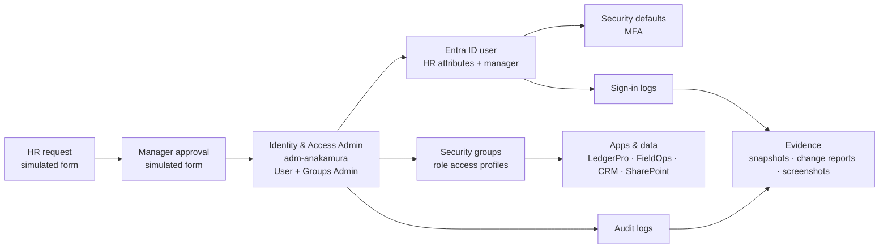
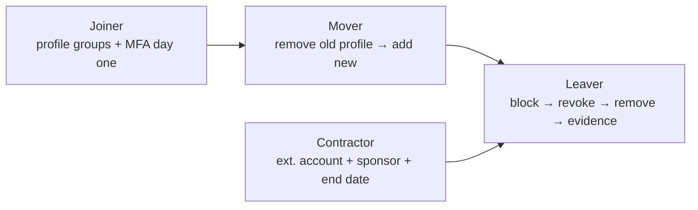
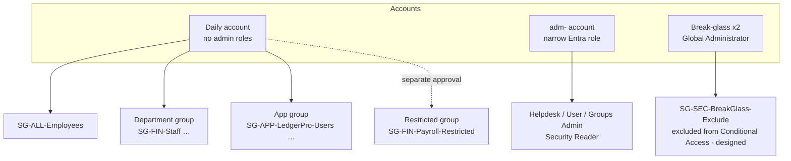

# Architecture

## 1. Identity governance overview

## 2. Lifecycle

## 3. Access model

## 4. Lab environment

| Component | Detail |
|---|---|
| Tenant | Microsoft Entra ID Free (dedicated test tenant) |
| Azure subscription | Expired — no Azure resources; Azure RBAC designed only |
| Identities | 17 employees + 1 joiner + 1 contractor; 3 `adm-` accounts; 2 break-glass; 1 lab owner admin |
| Groups | 20 assigned security groups with business owners |
| Automation | Microsoft Graph PowerShell (create, verify, snapshot, compare) |
| MFA | Security defaults + Microsoft Authenticator |
